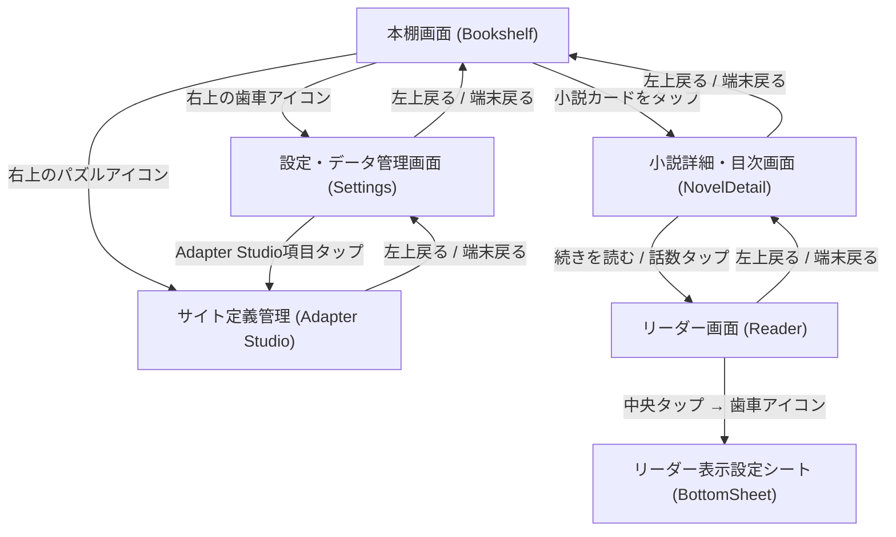

# UniversalNovelReader ユーザー取扱説明書（操作マニュアル）

本ドキュメントは、マルチサイトWeb小説リーダーアプリ「**UniversalNovelReader**」の画面構成、各機能、操作方法、および細かい動作仕様をまとめた説明書です。

---

## 1. アプリ概要

UniversalNovelReader は、「小説家になろう」をはじめとするWeb小説サイトの作品を快適に閲覧・管理するためのAndroid向けリーダーアプリです。

- **Web小説に最適化された横書きリーダー**: 上から下へスムーズにスクロールして読める自然なレイアウト。
- **高カスタマイズ性**: フォント（ゴシック/明朝）、文字サイズ、行間、余白、カラーテーマ（白/セピア/ダーク/漆黒）、およびCSSによる自由なスタイル指定。
- **マルチサイト対応**: サイト定義（YAML/Jsoup）により、デザイン変更や新サイト追加に柔軟に対応。
- **オフライン読書・キャッシュ機能**: 読んだエピソードや画像はローカルに保存され、通信環境がない場所でも閲覧可能。
- **CSVバックアップ・連携**: 本棚データをCSVとして入出力可能。

---

## 2. 画面構成と主な遷移

---

## 3. 各画面の機能と細かい動作仕様

### 3.1 本棚画面（ホーム画面）

アプリ起動時に表示されるメイン画面です。登録した小説の一覧と更新管理を行います。

| 操作・UI要素 | 動作内容・細かい仕様 |
| :--- | :--- |
| **タブ切り替え** | 「すべて」「連載中」「完結」をタップして一覧を絞り込み表示します。 |
| **小説カード** | タイトル、作者名、完結バッジ、全話数、最終確認日時を表示します。 タップすると「小説詳細・目次画面」へ遷移します。 |
| **小説追加ボタン（右下の「＋」）** | 小説登録ダイアログを開きます。 **【便利機能（クリップボード自動入力）】**: クリップボードに `http://` または `https://` で始まるURLがコピーされている場合、ダイアログを開いた瞬間に自動で入力欄にペーストされます。 |
| **一括更新チェック（右上の↻）** | 本棚にあるすべての小説の目次を順次Webから再チェックします。進捗バーとともに「更新チェック中 (1/3)...」と表示され、新しい話があれば話数が更新されます。 |
| **ブラウザ・他アプリからの共有連携** | Chrome等のブラウザでなろうの小説ページを開き、「共有」メニューから「UniversalNovelReader」を選択すると、URLが自動入力されて小説が登録され、詳細画面へダイレクト遷移します。 |

---

### 3.2 小説詳細・目次画面

1つの小説に関する詳細情報と全エピソードの目次を確認する画面です。

| 操作・UI要素 | 動作内容・細かい仕様 |
| :--- | :--- |
| **作品ヘッダー** | タイトル、作者名を表示します。 |
| **あらすじの展開/折りたたみ** | 初期状態ではあらすじは最大3行に省略されています。「▼ あらすじをもっと見る」をタップすると全文が展開され、「▲ 閉じる」で元に戻ります。 |
| **「続きを読む」ボタン** | **【進捗連動ボタン】** ・未読の場合: 「続きを読む (第1話: ○○)」と表示。 ・読書中の場合: 前回最後に読んだエピソードのタイトルが表示され、ワンタップで続きから再開できます。 |
| **目次ソート（全○話の右横の⇅）** | 目次リストを「昇順（1話〜）」と「降順（最新話〜）」でワンタップ切り替えできます。 |
| **エピソードリスト** | 各エピソードの「章タイトル」「サブタイトル」「更新・改稿日時」を表示します。 ・**章タイトル表示**: 「第１章　幼年期」などの章区切りが自動判別され、各話の上にヘッダー表示されます。 ・タップするとそのエピソードのリーダー画面が開きます。 |
| **目次更新ボタン（右上の↻）** | この小説のみ目次情報を再取得し、最新話を追加します（複数ページにまたがる目次も自動巡回します）。 |
| **小説削除ボタン（右上のゴミ箱）** | 小説データ、エピソード一覧、および保存済みの本文キャッシュをすべて削除して本棚へ戻ります。 |

---

### 3.3 リーダー画面（本文閲覧）

WebView技術を活用した、軽量で読みやすい横書き特化の読書画面です。

#### 基本操作
- **縦スクロール**: 上から下へ指一本でスムーズにスクロールできます（慣性スクロール対応）。
- **メニュー表示切り替え**: **画面中央付近をシングルタップ**すると、上部のヘッダーバーおよび下部の話数ナビゲーションバーが表示／非表示（トグル）します。
- **読書位置（しおり）の自動記憶**: スクロールを止めると、その位置（進行率）が自動的に保存されます。再度開いた際、前回の位置まで自動でスクロール復元されます。
- **自動既読判定**: ページの90%以上（末尾付近）まで読み進めると、自動的にそのエピソードの既読フラグがONになります。

#### 画面下部ナビゲーション（メニュー表示時）
- **「前の話」ボタン**: 1つ前のエピソードへ遷移します（第1話では無効化）。
- **話数カウンター**: 「1 / 286」のように現在位置と総話数を表示します。
- **「次の話」ボタン**: 1つ後のエピソードへ遷移します（最終話では無効化）。
- **本文末尾ボタン**: 本文の一番下までスクロールすると、メニューを出さなくても押せる「← 前の話」「次の話 →」ボタンが配置されています。

#### リーダー表示設定シート（右上のスライダーアイコン）
画面中央をタップしてメニューを出し、右上のスライダーアイコンをタップすると下から設定シートがせり上がります。変更内容は**リアルタイムに本文へ反映**され、次回以降も自動保存されます。

1. **カラーテーマ（4色）**:
   - **白 (White)**: 明るい日中向けの標準白背景。
   - **セピア (Sepia)**: 目に優しい落ち着いたクリーム系ペーパー調（デフォルト）。
   - **ダーク (Dark)**: 暗い場所で眩しくないグレー系ダークテーマ。
   - **漆黒 (Black)**: 有機EL（OLED）ディスプレイで消費電力を抑える完全な黒背景。
2. **フォント種別**:
   - **ゴシック体 (標準)**: スマホ画面で可読性の高いサンセリフ体（Web小説推奨）。
   - **明朝体**: 文庫本・小説特有の落ち着いたセリフ体。
3. **文字サイズスライダー**:
   - `12px` 〜 `32px` まで無段階で調整可能（標準: 18px）。
4. **行間スライダー**:
   - `1.2` 〜 `2.5` までゆったりとした行間比率を調整可能（標準: 1.85）。
5. **左右余白スライダー**:
   - `8px` 〜 `36px` までスマホのベゼルや好みに合わせて調整可能（標準: 16px）。

---

### 3.4 設定・データ管理画面

本棚右上の「歯車アイコン」から開く、アプリ全体の設定および外部データ連携画面です。

| 項目 | 説明・仕様 |
| :--- | :--- |
| **本棚をCSVエクスポート** | 本棚の小説一覧をCSV形式ファイルとして出力し、Androidの共有シートを開きます。Googleドライブへの保存、Keep、メール送信などでバックアップが取れます。 |
| **CSVファイルからインポート** | 端末内のCSVファイルを選択し、記載されているURLから小説を一括登録します。 |
| **CSVテキストを直接貼り付け** | クリップボード等にあるCSVテキストを貼り付けて一括登録します。 |
| **全体デフォルト カスタムCSS** | すべての作品・すべてのサイトに適用されるCSSを直接編集できます。ルビ文字の大きさや特定タグの非表示など、CSSによる高度なスタイリングが可能です。 |
| **キャッシュ容量表示** | 保存されている本文HTMLおよび挿絵画像の総データ容量をリアルタイム計算して表示します。 |
| **全キャッシュをクリア** | 保存済みの本文・画像をすべて削除します（本棚の登録情報やしおり位置は消えません）。ストレージを空けたい時に安全に利用できます。 |

---

### 3.5 サイト定義管理画面 (Adapter Studio)

本棚右上の「パズルアイコン」または設定画面から開く、Webスクレイピング解析エンジンの管理画面です。

- **組み込みアダプター**: 「小説家になろう（`syosetu_standard`）」が初期登録されており、なろう（ncode.syosetu.com）およびノクターン/ムーンライト（novel18.syosetu.com）の最新HTMLデザインに対応しています。
- **YAMLによる簡単定義**: プログラミングを行わなくても、CSSセレクタ（Jsoup）を指定するだけで新規小説サイトや個人サイトの解析ルールを追加できます。
- **ドメイン専用CSS**: サイト固有のルビ余白やスタイル調整用CSSを個別設定できます。
- **パーステスト機能**: URLを入力して「目次パーステスト」「本文パーステスト」を即座に実行し、セレクタが正しく当たっているかをその場で検証できます。

---

## 4. 便利な小ワザ・FAQ

- **Q. 本文が表示されない・真っ白な場合は？**
  - エピソードを初めて開く際はWebから本文をフェッチしてキャッシュに保存します。ネットワーク接続を確認し、再度エピソードをタップしてください。
- **Q. 他のアプリを操作しながら続きを読みたいときは？**
  - Androidの戻るボタンを押すだけで、読書位置（スクロール率）が自動的にデータベースへ記録されます。次回「続きを読む」を押せば元の位置からすぐ再開できます。
- **Q. 複数端末で本棚を同期したいときは？**
  - 「設定」→「本棚をCSVエクスポート」でCSVをクラウド（Google Drive等）に保存し、別端末のUniversalNovelReaderで「CSVファイルからインポート」を実行してください。

