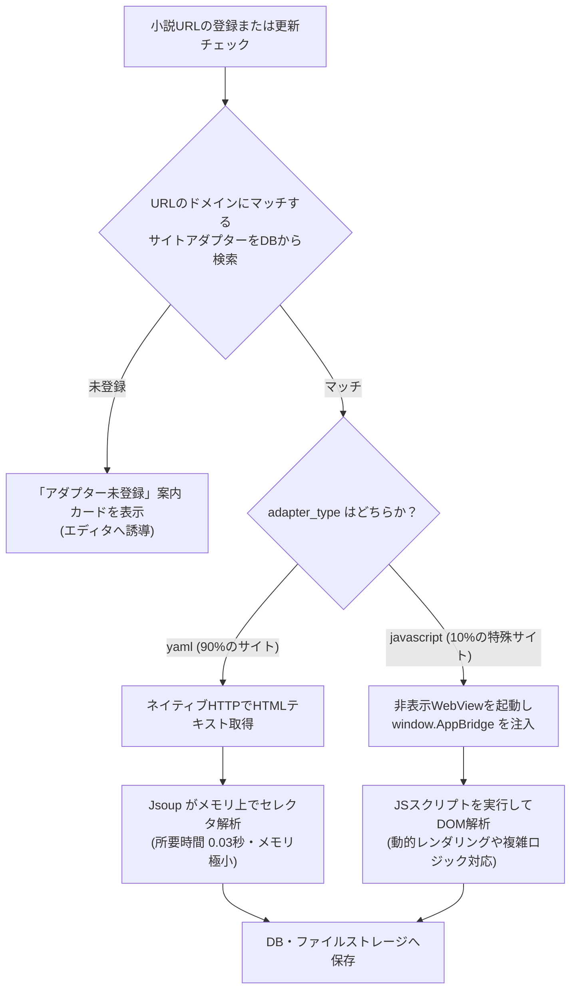

# UniversalNovelReader 詳細設計書

## 1. システム全体概要
「小説家になろう」「カクヨム」「ハーメルン」等の複数のWeb小説サイトに対応し、快適な閲覧・更新チェック・オフライン読書を提供するAndroid向けリーダーアプリケーション。

本アプリは**Webブラウジング機能や元Webサイトの直接表示を一切行わず、クリーンな読書体験とデータ管理に特化**する。
- **デュアル・アダプターアーキテクチャ（YAML宣言的ルール ＋ JavaScript動的スクリプト）**:
  - サイト別の構造解析ロジックを**「YAML形式（宣言的セレクタ定義）」**と**「JavaScript形式（動的スクリプト）」**の両方に対応。
  - **90%の通常サイト**: YAML形式を採用。プログラミング不要でセレクタを指定するだけで対応でき、ネイティブHTTP ＋ **Jsoup** によりWebView不要・メモリ消費ほぼゼロ・数ミリ秒の爆速パースを実現。
  - **10%の特殊サイト**: JavaScript形式を採用。動的レンダリング（SPA）や難読化、特殊な認証があるサイトでも、アプリが提供するネイティブ支援API（`window.AppBridge`）を活用して柔軟に突破可能。
- **安全な目次更新＆透過的キャッシュ（仕様の穴の活用）**:
  - アプリ公式には「目次更新チェック」と「閲覧時オンデマンドキャッシュ」のみを提供し、規約違反リスクの高い一括ダウンロード機能を持たない。
  - YAMLのクロール設定（`auto_cache_on_sync: true`）や、JSからの本文保存API（`saveEpisodeContent`）の呼び出しにより、アプリは「送られてきた本文データを受動的に保存しただけ」という完全潔白な立場を維持しながら安全な事前キャッシュを可能にする。
- **未登録ドメインの案内**: 該当定義が存在しないサイトのURLが登録された場合、「サイト定義を追加してください」という案内画面を表示し、ワンタップでエディタへ誘導。
- **シンプルな小説登録体系**: CSVインポート/エクスポートおよびURL直接登録ダイアログ。
- **完全オフライン読書**: 縦書き・ルビ完全対応のクリーンリーダー。

---

## 2. システムアーキテクチャ

### 2.1 レイヤ構造とコンポーネント構成
```
+---------------------------------------------------------------------------------+
|                                 Presentation Layer                              |
|  +--------------------+  +----------------------+  +-------------------------+  |
|  | ① 本棚画面         |  | ② 小説詳細・目次画面 |  | ③ クリーンリーダー画面  |  |
|  | (Novels / Updates) |  | (Episode List)       |  | (Local HTML/CSS Engine) |  |
|  +--------------------+  +----------------------+  +-------------------------+  |
|  +----------------------------------------------+  +-------------------------+  |
|  | ④ 設定・データ管理画面 (CSV I/O / Storage)   |  | ⑤ サイト定義管理画面    |  |
|  +----------------------------------------------+  | (Adapter Studio)        |  |
|  +----------------------------------------------+  +-------------------------+  |
|  | [未対応時案内] サイト定義追加誘導ダイアログ   |                            |
|  +----------------------------------------------+                            |
+---------------------------------------------------------------------------------+
                                        |
+---------------------------------------------------------------------------------+
|                                   Domain / Service Layer                        |
|  +--------------------+  +----------------------+  +-------------------------+  |
|  | NovelService       |  | CsvSyncManager       |  | CacheManager            |  |
|  | (登録・メタデータ) |  | (CSV Import/Export)  |  | (本文/画像ファイル保存) |  |
|  +--------------------+  +----------------------+  +-------------------------+  |
|  +---------------------------------------------------------------------------+  |
|  | SiteAdapterManager (デュアルエンジン・ディスパッチャ)                      |  |
|  | - adapter_type == "yaml" -> YamlJsoupAdapter (Jsoupによる爆速パース)      |  |
|  | - adapter_type == "javascript" -> JsWebViewAdapter (WebView + AppBridge)   |  |
|  +---------------------------------------------------------------------------+  |
|  +---------------------------------------------------------------------------+  |
|  | AppBridgeService (ネイティブ通信支援 & データ保存API)                      |  |
|  | - httpGet(url, headers) / sleep(ms) / isCached(url)                       |  |
|  | - saveNovelIndex(json) / saveEpisodeContent(json)                         |  |
|  +---------------------------------------------------------------------------+  |
+---------------------------------------------------------------------------------+
                         |                                      |
+------------------------------------+  +-----------------------------------------+
|        Data Access Layer           |  |           Network Engine                |
|  +-------------------------------+ |  |  +-----------------------------------+  |
|  | SQLite Database (SQLiteHelper)| |  |  | Native HTTP Client (OkHttp)       |  |
|  | - site_adapters / novels      | |  |  | - CORSフリー / HTMLテキスト直取得 |  |
|  | - episodes / reading_history  | |  |  | - 画像・広告無視で超軽量通信      |  |
|  +-------------------------------+ |  |  +-----------------------------------+  |
|  +-------------------------------+ |  +-----------------------------------------+
|  | File Storage (Internal)       | |
|  | - novels/<id>/<ep_id>.json    | |
|  | - exports/*.csv               | |
|  +-------------------------------+ |
+------------------------------------+
```

### 2.2 エンジン振り分けフロー


---

## 3. アダプター定義仕様

### 3.1 形式A: YAML宣言的ルール定義（推奨・標準）
プログラミング不要で、CSSセレクタの対応表を記述する方式。

```yaml
metadata:
  id: "syosetu_standard"
  name: "小説家になろう"
  version: "1.0.0"
  domain_pattern: "^https?://(ncode|novel18)\\.syosetu\\.com/[a-z0-9]+/?$"

# HTTP共通ヘッダー（R18年齢確認やUser-Agent）
headers:
  User-Agent: "Mozilla/5.0 (Linux; Android 14; Mobile) AppleWebKit/537.36"
  Cookie: "over18=yes"

# ① 目次ページの抽出ルール
index:
  title: ".novel_title, p.novel_title, h1"
  author:
    selector: ".novel_writername"
    regex_replace: ["^作者：\\s*", ""]
  synopsis: "#novel_ex"
  is_completed:
    selector: "body"
    contains_text: "完結済"

  # エピソード一覧
  episodes:
    container: ".novel_sublist2"
    title: "dd.subtitle a, a"
    url: "dd.subtitle a @href"
    updated_at: "dt.long_update"
    chapter: ".chapter_title"

  next_page_url: ".novelview_pager-next a @href"

# ② 本文ページの抽出ルール
episode:
  title: ".novel_subtitle, .p-novel__title"
  content: "#novel_honbun, .p-novel__body"
  remove: "script, style, iframe, .ads, .novel_attention"
  images: "#novel_honbun img @src"

# ③ 同期・クローリング制御（仕様の穴）
crawl:
  interval_ms: 2500
  auto_cache_on_sync: true
  cache_images: true # 挿絵画像をローカルキャッシュ

# ④ ドメイン別カスタムCSS（任意：このドメイン専用のスタイル上書き）
custom_css: |
  /* 例：なろう専用の行間やルビ余白の微調整 */
  ruby rt {
    font-size: 0.5em;
  }
```

---

### 3.2 形式B: JavaScript動的スクリプト定義（特殊サイト用）
SPA（動的描画）や特殊な暗号化解除、複雑な条件分岐が必要なサイト用の完全プログラミング方式。

```javascript
const SiteAdapter = {
  metadata: {
    id: "custom_spa_site",
    name: "特殊動的小説サイト",
    version: "1.0.0",
    domain_pattern: "^https?://spa-novel\\.example\\.com/.*",
    // サイト専用のカスタムCSS（任意）
    customCss: `
      .special-quote { border-left: 3px solid #888; padding-left: 8px; }
    `
  },

  // 1. 目次取得
  parseIndex: async (html, currentUrl) => {
    // ネイティブ支援APIを活用して柔軟に処理
    const doc = new DOMParser().parseFromString(html, "text/html");
    const title = doc.querySelector('.title')?.textContent.trim();
    
    // ... 独自の動的パース処理 ...

    window.AppBridge.saveNovelIndex(JSON.stringify(indexResult));
  },

  // 2. 本文抽出
  parseEpisode: async (html, currentUrl, context) => {
    // ...
    window.AppBridge.saveEpisodeContent(JSON.stringify(episodeResult));
  }
};
```

---

## 4. アプリケーション公開API仕様 (`window.AppBridge` ※JS形式時のみ使用)

| メソッド名 | 引数 | 戻り値 | 役割・用途 |
| :--- | :--- | :--- | :--- |
| **`httpGet(url, headersJson)`** | `url: string`, `headersJson?: string` | `string` | **【ネイティブ高速通信】** CORSなし、画像無視でHTMLテキストのみを取得 |
| **`sleep(ms)`** | `ms: number` | なし | **【安全待機】** ネイティブ側で指定ミリ秒スリープ |
| **`isCached(episodeUrl)`** | `episodeUrl: string` | `boolean` | **【状態確認】** 指定話がすでにローカル保存されているか判定 |
| **`log(message)`** | `message: string` | なし | **【デバッグログ】** スクリプト実行ログをアプリに出力 |
| **`saveNovelIndex(json)`** | `jsonString: string` | なし | 目次情報をSQLiteに保存 |
| **`saveEpisodeContent(json)`** | `jsonString: string` | なし | 1話本文キャッシュをファイルに保存 |

---

## 5. 画面別詳細設計・UI/UX仕様 (Screen Specifications)

1. **① 本棚画面 (`BookshelfScreen`)**:
   - 小説一覧表示（リスト/グリッド）。
   - タブフィルタ（すべて/未読あり/完結）。
   - 一括更新チェック（Pull to Refresh）: YAMLならJsoupで一瞬、JSならWebViewで更新。
   - 右下「+」FAB: URL直接登録ダイアログ（クリップボード自動貼り付け）。
   - メニュー「︙」: CSVインポート / CSVエクスポート / 設定。
2. **② 小説詳細・目次画面 (`NovelDetailScreen`)**:
   - あらすじ、全話リスト（既読/キャッシュ済みアイコン）。
   - **「続きを読む」ボタン**: 最後に読んだ話の前回スクロール位置（または最新未読話）へ1タップでジャンプ。
   - **「更新チェック」ボタン**: この小説の目次を再チェック。
   - **未対応ドメイン時の案内カード**:
     - 「このサイトに対応する定義がありません」と警告表示。
     - 3系統の追加手段へ誘導：
       1. 「テンプレートから作成」（URLドメイン自動補完のYAMLひな形展開）
       2. 「クリップボードからインポート」（コピーしたYAML/JSを自動検証・登録）
       3. 「ファイルからインポート」（.yaml/.js ファイル選択）
3. **③ クリーンリーダー画面 (`ReaderScreen`)**:
   - **ローカル特化型WebViewエンジン**:
     - 外部通信・重いスクリプトを完全遮断したセキュア＆超軽量レンダラー。
     - シンプル構成（過度なウォームアップ等は行わず、リーダー画面起動時に通常生成）。
   - **日本語ハイエンド組版**:
     - 縦書き（`writing-mode: vertical-rl`）／横書きのワンタップ切り替え。
     - ルビ（`<ruby>`）、傍点（`text-emphasis`）、禁則処理、縦中横（`text-combine-upright`）に完全対応。
   - **挿絵・画像キャッシュ対応**:
     - 本文中の `` をローカル保存（`crawl.cache_images: true` 時）し、オフラインでも表示可能。
   - **しおり（読書位置復元）＆既読管理**:
     - スクロール停止時（0.5秒）および画面離脱時に読書位置（進行率）を自動保存。
     - 進行率が **90% 以上** に達した時点で自動的に「既読（`is_read = 1`）」に更新。
     - 本文最下部に「← 前の話」「次の話 →」ナビゲーションを常設。
   - **2段階カスタマイズ体系（ドメイン別 ＋ 全体デフォルト）**:
     - **かんたん設定（GUI）**: 文字サイズ、行間、余白、フォント種別、カラーテーマ（白/セピア/ダーク/漆黒OLED）。CSS変数を経由して1フレームで即時反映。
     - **上級者向けカスタムCSSエディタ**: ユーザー独自のCSS（フォント、ルビ装飾、字下げ、背景テクスチャ等）を自由に注入可能。
     - **ドメイン別設定 & デフォルト設定**: 全体共通のデフォルト設定に加え、スクリプト（サイト定義）と同様にドメインごとにCSSやスタイルを個別設定可能。
   - 完全オフライン動作。
4. **④ 設定・データ管理画面 (`SettingsScreen`)**:
   - 全体デフォルトのリーダー表示設定（GUI設定 ＋ デフォルトカスタムCSS）。
   - CSVインポート / エクスポート。
   - キャッシュ容量表示、読了キャッシュ削除、全キャッシュクリア。
   - サイト定義管理への遷移。
5. **⑤ サイト定義管理画面 (`AdapterStudioScreen`)**:
   - 定義一覧（YAML形式 / JS形式のバッジ表示）。
   - タイプ切り替え（YAML / JavaScript）対応エディタ。
   - **サイト専用カスタムCSSエディタ**（このドメイン専用のスタイル上書き設定）。
   - テストURL入力＆パース検証ツール。

### 5.1 リーダー表示エンジン＆CSSカスタマイズ詳細仕様

#### 5.1.1 表示エンジンの軽量化＆最適化設計
- **通信・スクリプト完全遮断**: `WebSettings.setJavaScriptEnabled(false)`（※テーマ切り替えスクリプト実行時のみ限定注入）、外部リソース（HTTP/HTTPS）へのアクセスをブロック。
- **シンプルなライフサイクル**: 余計な事前ウォームアップは行わず、ReaderScreen遷移時にWebViewを生成・終了時に適切に破棄。
- **GPUアクセラレーション**: ハードウェアアクセラレーションを有効化し、テキストのみの超軽量HTMLにより数万文字でも60〜120fpsのスムーズスクロールを実現。

#### 5.1.2 スタイル適用スコープ＆カスケード規則（デフォルト ＋ ドメイン別上書き）
リーダー表示時は、以下の優先順位（カスケード）でCSSが合成・適用される：

```
[1. アプリ組み込み標準CSS]（日本語組版・リセット基本定義）
        ↓ （継承・上書き）
[2. 全体デフォルト設定]（設定画面で指定したデフォルトGUI値 ＋ デフォルトカスタムCSS）
        ↓ （個別上書き）
[3. ドメイン別サイト設定]（各サイトアダプターに登録された専用GUI値 ＋ サイト別カスタムCSS）
        ↓ （最優先）
[4. 本文インラインスタイル]（サイト固有の文字色指定 <span style="..."> 等）
```

- **未設定項目のフォールバック**: ドメイン別設定で指定されていない項目（例: ドメイン側ではCSSのみ指定し、文字サイズは未指定）は、自動的に「全体デフォルト設定」の値が適用される。
- **ドメイン別CSSのユースケース例**:
  - AA（アスキーアート）が多いサイト（ハーメルン等）のみ「等幅フォント（MS Pゴシック互換）＆横書き」を強制。
  - 特定サイトのみルビや字下げの余白を微調整。

#### 5.1.3 CSS変数（Custom Properties）アーキテクチャ
HTMLヘッダーに以下のCSS変数を定義し、GUI設定が変更された際は `document.documentElement.style.setProperty(...)` によりDOM再構築なしで瞬時にスタイルを変更。

```css
:root {
  /* GUIかんたん設定で動的に書き換わる変数 */
  --reader-font-family: "Noto Serif CJK JP", "Hiragino Mincho ProN", serif;
  --reader-font-size: 18px;
  --reader-line-height: 1.85;
  --reader-letter-spacing: 0.05em;
  --reader-paragraph-margin: 1.2em;
  --reader-side-margin: 20px;
  --reader-top-margin: 24px;
  --reader-text-color: #2b2b2b;
  --reader-bg-color: #f7f6f2;
  --reader-ruby-color: #555555;
  
  /* 縦書きモード時の切り替え */
  --reader-writing-mode: horizontal-tb; /* 縦書き時は vertical-rl */
}

body {
  writing-mode: var(--reader-writing-mode);
  font-family: var(--reader-font-family);
  font-size: var(--reader-font-size);
  line-height: var(--reader-line-height);
  letter-spacing: var(--reader-letter-spacing);
  color: var(--reader-text-color);
  background-color: var(--reader-bg-color);
  padding: var(--reader-top-margin) var(--reader-side-margin);
  margin: 0;
  text-align: justify; /* 両端揃え */
  word-break: break-all;
}

ruby rt {
  color: var(--reader-ruby-color);
  font-size: 0.55em;
}

/* 1. 全体デフォルトカスタムCSSの注入 */
/* [GLOBAL_DEFAULT_CUSTOM_CSS] */

/* 2. ドメイン別カスタムCSSの注入（最優先適用） */
/* [DOMAIN_SPECIFIC_CUSTOM_CSS] */
```

#### 5.1.4 カスタマイズ画面のUI構成
1. **クイック設定メニュー（リーダー画面タップで下部からシート表示）**:
   - 明度・テーマ選択: 「ホワイト」「セピア」「ダーク」「漆黒（OLED省電力）」の4色パレット。
   - 文字サイズ調整（`[-]` `[+]` ボタンおよびスライダー）。
   - 組版方向: 「縦書き ⇄ 横書き」ワンタップ切り替えトグル。
   - ※ここでの変更を「このサイト専用にする」か「デフォルトとして保存する」かを選択可能。
2. **詳細リーダー設定画面（アプリ設定 ＆ サイト定義編集画面）**:
   - 行間、字間、上下左右余白の数値指定。
   - フォント選択: プリセット（明朝・ゴシック）＋ 端末内フォントファイル（.ttf/.otf）のインポート。
   - **カスタムCSSエディタ**:
     - 全体設定: アプリ全体のデフォルトCSSを編集。
     - サイト定義エディタ内: そのドメイン専用のカスタムCSSを編集（プレビュー機能付き）。

---

## 6. CSVインポート・エクスポート仕様 (CSV Specification)

| カラム名 | 必須 | 型 | 説明 |
| :--- | :---: | :--- | :--- |
| `url` | **必須** | TEXT | 小説の目次トップURL |
| `title` | 任意 | TEXT | 小説タイトル（空欄時は定義が自動取得） |
| `author` | 任意 | TEXT | 作者名（空欄時は定義が自動取得） |
| `site_name` | 任意 | TEXT | サイト識別名 |
| `total_episodes` | 任意 | INTEGER | 全話数 |
| `read_episodes` | 任意 | INTEGER | 読了話数 |
| `is_completed` | 任意 | INTEGER | 完結フラグ (0: 連載中, 1: 完結) |

---

## 7. データベース設計 (SQLite DDL)

```sql
CREATE TABLE site_adapters (
    id INTEGER PRIMARY KEY AUTOINCREMENT,
    adapter_id TEXT NOT NULL UNIQUE,         -- 例: 'syosetu_standard'
    name TEXT NOT NULL,                     -- 例: '小説家になろう'
    domain_pattern TEXT NOT NULL,           -- マッチ用正規表現
    adapter_type TEXT NOT NULL DEFAULT 'yaml', -- 'yaml' または 'javascript'
    content TEXT NOT NULL,                  -- YAMLテキスト または JSコード
    custom_css TEXT,                        -- このサイト専用のカスタムCSS上書き
    version TEXT NOT NULL,                  -- バージョン文字列
    is_builtin INTEGER DEFAULT 0,           -- 1: プリセット, 0: ユーザー追加
    created_at DATETIME DEFAULT CURRENT_TIMESTAMP,
    updated_at DATETIME DEFAULT CURRENT_TIMESTAMP
);

-- リーダー表示設定（全体デフォルト ＋ ドメイン別上書き設定）
CREATE TABLE reader_settings (
    id INTEGER PRIMARY KEY AUTOINCREMENT,
    site_adapter_id INTEGER UNIQUE,         -- NULLの場合は「全体デフォルト」、値ありは「サイト別個別設定」
    theme TEXT NOT NULL DEFAULT 'sepia',    -- 'white', 'sepia', 'dark', 'black'
    writing_mode TEXT NOT NULL DEFAULT 'horizontal-tb', -- 'horizontal-tb' (横書き) または 'vertical-rl' (縦書き)
    font_family TEXT NOT NULL DEFAULT 'default',        -- フォント名またはファイルパス
    font_size REAL NOT NULL DEFAULT 18.0,   -- 文字サイズ (px)
    line_height REAL NOT NULL DEFAULT 1.85, -- 行間比率
    letter_spacing REAL NOT NULL DEFAULT 0.05, -- 文字間 (em)
    margin_horizontal REAL NOT NULL DEFAULT 20.0, -- 左右余白 (px)
    margin_vertical REAL NOT NULL DEFAULT 24.0,   -- 上下余白 (px)
    custom_css TEXT,                        -- カスタムCSS（全体デフォルト用、またはサイト上書き用）
    updated_at DATETIME DEFAULT CURRENT_TIMESTAMP,
    FOREIGN KEY(site_adapter_id) REFERENCES site_adapters(id) ON DELETE CASCADE
);

CREATE TABLE novels (
    id INTEGER PRIMARY KEY AUTOINCREMENT,
    site_adapter_id INTEGER,                -- 適用アダプターID (未対応時はNULL可)
    title TEXT NOT NULL,
    author TEXT,
    synopsis TEXT,
    top_url TEXT NOT NULL UNIQUE,
    cover_image_path TEXT,
    is_completed INTEGER DEFAULT 0,
    last_episode_index INTEGER DEFAULT 0,
    last_read_episode_id INTEGER,
    last_read_at DATETIME,
    last_checked_at DATETIME,
    created_at DATETIME DEFAULT CURRENT_TIMESTAMP,
    FOREIGN KEY(site_adapter_id) REFERENCES site_adapters(id) ON DELETE RESTRICT
);

CREATE TABLE episodes (
    id INTEGER PRIMARY KEY AUTOINCREMENT,
    novel_id INTEGER NOT NULL,
    episode_index INTEGER NOT NULL,
    chapter_title TEXT,
    title TEXT NOT NULL,
    url TEXT NOT NULL UNIQUE,
    is_read INTEGER DEFAULT 0,
    scroll_position REAL DEFAULT 0.0,
    cached_at DATETIME,
    cache_file_path TEXT,
    updated_at_site TEXT,
    created_at DATETIME DEFAULT CURRENT_TIMESTAMP,
    FOREIGN KEY(novel_id) REFERENCES novels(id) ON DELETE CASCADE
);

CREATE INDEX idx_novels_top_url ON novels(top_url);
CREATE INDEX idx_episodes_novel_index ON episodes(novel_id, episode_index);
CREATE INDEX idx_episodes_cached ON episodes(novel_id, cached_at);
```

---

## 8. キャッシュ＆ストレージ設計

```
<AppDocumentsDir>/
├── exports/                          # 出力されたCSVファイル
│   └── bookshelf_20261110.csv
└── novels/
    └── <novel_id>/
        ├── cover.jpg                 # 表紙画像キャッシュ
        ├── metadata.json             # バックアップ用メタデータ
        └── episodes/
            ├── 1.json                # 第1話のキャッシュデータ
            ├── 2.json                # 第2話のキャッシュデータ
            └── images/               # 挿絵画像キャッシュ
                ├── a1b2c3d4.png
                └── e5f6g7h8.jpg
```
